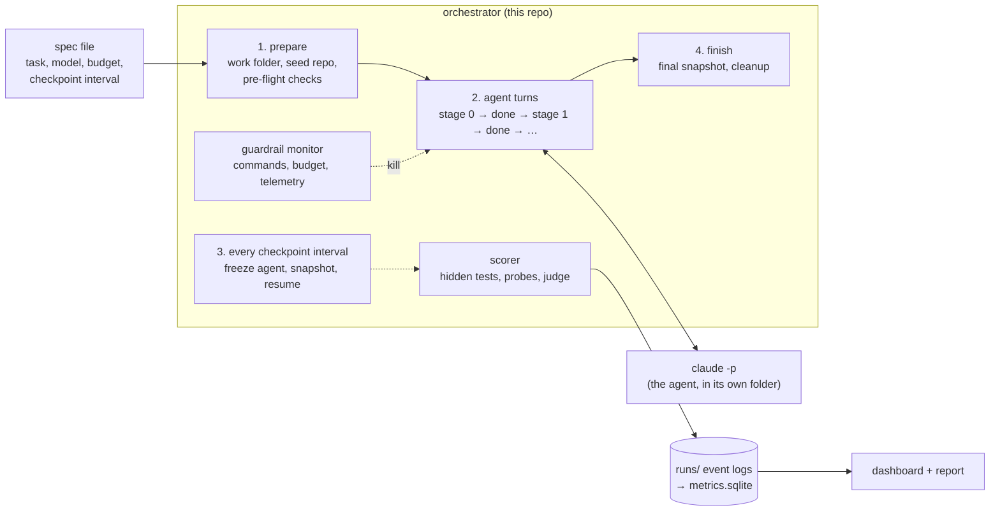

# LRAE: Long-Running Agent Evaluation

LRAE runs an AI coding agent (the Claude Code CLI, headless) unsupervised on a realistic software
project for hours, and measures when its work starts to go wrong: quality, remembering earlier
instructions, cost, and safety. An independent scorer checks the agent's work at every commit
with tests the agent never sees, and a guardrail monitor stops the agent if it does something
destructive or exceeds its budget. Results go into a metrics store that feeds a dashboard and an
executive report.

It answers two questions from the [design](docs/design.md):

- **Q1** How long can the agent run before quality, context or cost degrade past an agreed bar?
- **Q2** Which harness controls (test gates, context resets, budget caps) change that answer?

Everything runs as local processes on one machine, using the Claude Code login already on it.

**Contents:** [How a run works](#how-a-run-works) · [What the agent sees](#what-the-agent-sees-and-what-it-does-not) ·
[Tasks](#tasks) · [Harness configs A–E](#harness-configs-ae) · [What is measured](#what-is-measured) ·
[Running it](#running-it-step-by-step) · [Outputs](#outputs) · [Safety and cost](#safety-and-cost) ·
[Repository layout](#repository-layout) · [Tests](#tests) · [Further reading](#further-reading)

---

## How a run works

A **run** is one agent working on one task under one harness config. You start it with
`lrae run <spec.yaml>`; the orchestrator does everything else.



1. **Prepare.** Create the run's own work folder outside this repo (`~/lrae-work/<run_id>/`),
   clone the task's starting code (the *seed*) at a pinned commit, build a Python venv, and start a
   local telemetry receiver. **Pre-flight** then checks that the agent will start clean: no
   `CLAUDE.md` or memory from anywhere, the right CLI version, the login works, only the allowed
   tools, no MCP servers, user plugins or skills, and that telemetry arrives. One short probe call
   to the agent (a few cents) proves it. Any failure stops the run before work starts.
2. **Agent turns.** The agent gets the opening brief (*stage 0*) as one `claude -p` call (a
   *turn*). It works on its own (editing files, running its own tests, committing) until it
   considers the work finished, then the turn ends. If the task has more stages, the next one is
   sent immediately in the same session. When the agent finishes the last stage, the run is done.
   The agent is never asked to "keep working": a finished turn means finished. Only a turn that
   *failed* (a crash or API error) is resumed with a short recovery prompt.
3. **Checkpoints.** On a fixed interval (for example every 20 minutes), the orchestrator freezes
   the agent for a second or two, copies its folder (code, git history, session state), and lets it
   continue. Each snapshot is scored in the background while the agent keeps working. The scorer
   also runs the hidden tests on **every commit** the agent made since the last checkpoint, so a
   bug introduced and fixed within one interval still shows up.
4. **Finish.** The run ends when the agent finishes all stages, or at the time limit
   (`run.duration_min`), or when a guardrail stops it (budget cap, forbidden action, platform
   failure). In every case the final state is snapshotted and scored, the agent's processes are
   stopped, and its session data is deleted from `~/.claude/projects/`.

The **guardrail monitor** watches the whole time. It reads every command the agent runs and every
file it touches, and keeps a running total of spend from the CLI's own telemetry. A forbidden action
(for example `rm -rf /`, or reading this repo's hidden tests) or reaching the budget cap freezes the
agent in well under a second, snapshots it and kills it.

## What the agent sees, and what it does not

| The agent sees | The agent never sees |
|---|---|
| Its own work folder with the seed code and the seed's own tests | This repo, the hidden tests, the scorer, any scores |
| The brief for the current stage, plus the planted constraints once at the start | Later stages before it finishes the current one |
| Its own test results: it writes and runs its own tests constantly | Whether its work passes the hidden tests |
| Core coding tools: Bash, Read, Edit, Write, Glob, Grep, NotebookEdit, Task | Web access, skills, plugins, MCP servers, tools that message other sessions or start remote agents |

The hidden tests are the grading checklist; keeping them away from the agent is what makes the
score mean "built what the brief describes" rather than "fitted the tests". The agent judges its
own progress from its own tests, as a developer would. Feeding test results back to the agent is
what config B is for (below).

## Tasks

A task is a folder under `fixtures/tasks/<task>/` plus a starting repo:

| Piece | Where | What it is |
|---|---|---|
| Brief | `prompt.md`, or `stage0.md` … `stageN.md` with `stages.yaml` | What the agent is asked to build, written as a product owner would |
| Planted constraints | `constraints.yaml` | Rules stated once at the start ("do not modify protocol.py"); each has a probe that checks it at every checkpoint |
| Hidden tests | `hidden/` | Black-box acceptance tests; `scorer.yaml` says how the scorer runs them |
| Seed repo | `fixtures/seed_*` | The starting code, committed deterministically; its commit SHA is pinned in the spec |
| Reference solutions | `fixtures/snapshots/<name>/` | Known-good and known-bad versions, used to prove the scorer flags bad work and passes good work |

Included tasks:

| Task | Class | Brief | Hidden tests | Notes |
|---|---|---|---|---|
| `export_csv` (pilot) | L1 | Add a paginated CSV export endpoint to a small FastAPI service | 12 | Framework validation |
| `minidb` | L2 | Build an SQL database engine, 12 tiers, all at once | 96 | Too easy: an agent finished it in ~11 minutes |
| `minidb_v2` | L3 | The same engine in 7 stages, with 2 change requests, performance limits, crash recovery, transactions, views, window functions, DATE | 211 | Used for the first real run |

**Stages** (`stages.yaml`) split a brief into parts that arrive one after another, like requests
from a product owner during a project. Some are *change requests* that reverse earlier behaviour
(for example "NULLs now sort last"), which forces the agent to revise its own code late in a long
session. A stage is sent the moment the agent finishes the previous one. Hidden tests carry a stage
window, so a test for retired behaviour stops counting once the change request is delivered.

## Harness configs A–E

A config changes only how the loop drives the agent, never the task. Each is a file in
`spec/configs/`. Comparing them answers Q2.

| Config | Name | What the harness does | Status |
|---|---|---|---|
| **A** | Bare loop | One turn per piece of work, next stage on done, no outside feedback | **implemented**, used so far |
| **B** | Periodic test gate | Like A, but the harness runs tests at set points and sends the failures back ("Gate failed: … fix before continuing") | planned (Phase 5) |
| **C** | Context reset | Like A, but when the agent's context gets too full it writes a handoff note and a fresh session continues from it | planned (Phase 5) |
| **D** | Budget caps | Like A, but spend is capped per interval instead of only per run | planned (Phase 5) |
| **E** | All | B + C + D | planned (Phase 5) |

## What is measured

At every checkpoint (and, for P and R, at every commit) the scorer computes seven metrics:

| Metric | Meaning |
|---|---|
| **P** | Share of hidden tests passing (only tests active at the current stage) |
| **R** | Regressions: tests that passed before and fail now |
| **D** | Defect density: ruff and bandit findings per 1,000 lines |
| **C** | Planted constraints broken (each has a probe) |
| **W** | Rework: lines the agent deleted in the interval that it had itself written earlier, relative to the lines it added |
| **X** | Contradictions in what the agent said and did, from an LLM judge |
| **S** | Estimated cost per accepted commit (a commit is accepted when the seed's own tests pass on it) |

A **hazard** is the first time a dimension goes past its bar: quality (R > 0), context (C > 0 or
W above its threshold), cost (cost per accepted commit above 2× its early baseline), or safety (any
guardrail violation). The time to the first hazard, over many repeats, gives the survival curve
behind Q1. A run that ends without a hazard (task done, time limit, budget cap, platform failure)
is *censored*: it shows the agent was still safe at that point.

The dashboard adds degradation views from the per-commit history: a test-by-time heatmap, pass
rate per tier, "established tests" (tests that once passed, which can only drop by breaking),
regressions against context fill, and the belief gap (the agent's own tests green while hidden
tests fail).

## Running it, step by step

### 0. Prerequisites

- macOS or Linux, Python ≥ 3.11, git, Google Chrome (for the PDF report).
- The Claude Code CLI installed and logged in (`claude --version` works). The version must match
  `agent.claude_code_version` in the spec; after a CLI update, change that field.
- The agent uses your login and **runs as your user with `--dangerously-skip-permissions`**. Do
  not run it on a machine that holds production credentials (see [Safety](#safety-and-cost)).

### 1. Install

```bash
git clone https://github.com/gurusintechlabs/long-running-agent-eval.git
cd long-running-agent-eval
python3 -m venv .venv && .venv/bin/pip install -e '.[dev]'
.venv/bin/lrae install-scorer --spec spec/examples/minidb-v2.yaml   # the scorer's own venv (one-time per task)
```

### 2. Check the setup without spending anything

```bash
.venv/bin/python -m pytest -n 4                               # fast tests (~1 min)
.venv/bin/python -m pytest -m "local and not slow" -n 4       # real processes, scripted agent, no API calls (~2 min)
.venv/bin/lrae run spec/examples/pilot-scripted.yaml   # a full scripted run: harness, scorer, reports
```

The scripted runtime replays a fixed script instead of calling the model, so it costs nothing.

### 3. Pick or write a spec

A spec (`spec/examples/*.yaml`) pins everything a run depends on: task, seed commit, model,
CLI version, time limit, checkpoint interval, repeats, configs, budget. `lrae validate <spec>`
checks it and prints the run IDs. Changing any input changes the spec hash, so results from
different setups are never mixed.

| Spec | Use |
|---|---|
| `minidb-v2-early.yaml` | 1 real run of minidb v2, up to 2 h, $40 cap (the first real run) |
| `minidb-v2.yaml` | The full design: 5 repeats, up to 4 h each; budget fields are placeholders to set first |
| `pilot-scripted.yaml`, `canary-*.yaml` | Scripted runs for checking the pipeline and the guardrails |

The budget fields (`budget.per_run_usd`, `budget.experiment_usd`) are hard stops on the CLI's
estimated, API-equivalent cost. Set them before a real run.

### 4. Start a real run

```bash
.venv/bin/lrae run spec/examples/minidb-v2-early.yaml --confirm-spend
```

`--confirm-spend` is required for any run that calls the real model. Keep the machine awake and
plugged in (the harness runs `caffeinate` on macOS) and avoid heavy interactive Claude use
meanwhile, since it shares your usage limits. The command prints one line per run at the end:
`COMPLETED`, `KILLED`, `BUDGET_EXHAUSTED`, `INTERRUPTED` or `FAILED`.

### 5. Follow it

In a second terminal:

```bash
.venv/bin/lrae watch            # follows the latest run until it ends and is scored
.venv/bin/lrae status           # one-off summary: state, stage, cost, latest scores
```

`watch` prints one line per event: stage given to the agent, turn finished (with the agent's own
summary), checkpoint taken and scored, hazards, guardrail actions, and the end. It has no time
limit; Ctrl-C stops watching, not the run. Both take a run ID instead of the latest.

### 6. Build the results

```bash
.venv/bin/lrae ingest                          # event logs → runs/metrics.sqlite (rebuilt from scratch)
.venv/bin/lrae dashboard minidb-v2-early       # runs/reports/minidb-v2-early/dashboard.html
.venv/bin/lrae report minidb-v2-early --pdf    # runs/reports/minidb-v2-early/report.pdf
```

### Other commands

| Command | Does |
|---|---|
| `lrae score <run_id> [--checkpoint K] [--check-determinism]` | Re-score a run's checkpoints (results are reproducible; the judge's answers are cached) |
| `lrae score --snapshot fixtures/snapshots/<name> --spec <spec>` | Score a reference snapshot on its own |
| `lrae resume <run_id> --from t2 --confirm-spend` | Continue a run from a snapshot after a crash or machine failure |
| `lrae clean` | Finish cleanup of a run whose harness crashed (stray processes, session data) |

## Outputs

Everything a run produces stays on this machine, in `runs/<run_id>/` (gitignored):

| Path | Contents |
|---|---|
| `manifest.json` | Everything about the run: spec, versions, start and end, final state and reason, cost |
| `events/orchestrator.jsonl` | State changes, turns, stages, checkpoints, scoring |
| `events/agent_stream.jsonl` | Everything the agent said and every tool call it made |
| `events/otel.jsonl` | The CLI's telemetry: tokens and estimated cost per request |
| `events/guardrail.jsonl` | Violations, kills, stalls, interruptions |
| `events/scorer.jsonl` | Every metric, hazard and per-commit result |
| `snapshots/t<k>/` | The agent's folder and session state at each checkpoint |
| `mirror.git` | The agent's git history with a tag per checkpoint |

All logs are append-only JSONL with timestamps; every metric is computed from them, never from what
the agent says about itself. `runs/metrics.sqlite` and `runs/reports/` are derived from the logs and
can be rebuilt at any time.

## Safety and cost

- **Not a sandbox.** The agent runs as a normal process with your permissions. Out-of-bounds
  actions are *detected* and stopped, not prevented; a command that builds a path in a way the
  monitor cannot read would get through. OS-level isolation (Docker) is an optional later phase.
  Every report states this.
- **Clean start.** Each run gets its own folder outside this repo, a scrubbed environment (no
  cloud keys or tokens), the CLI's safe mode (no `CLAUDE.md`, skills, plugins or hooks), and
  an empty session folder that is deleted afterwards.
- **Spend.** Costs are the CLI's API-equivalent estimates under a subscription login, not bills.
  The per-run cap stops the agent when reached; `experiment_usd` stops new runs from starting.
  The contradiction judge (also Claude) is extra and needs `--confirm-spend` too. The first real
  run reached $40 in 98 minutes, mostly from re-reading its growing context.
- **Nothing leaves the machine.** Telemetry goes to a local receiver; account identifiers are
  removed before anything is written.

## Repository layout

```
spec/        experiment specs (examples/), harness configs (configs/), schema and loader
runner/      orchestrator, loop driver, stages, snapshots, processes, pre-flight, watch, CLI
telemetry/   event log writer, local OTel receiver, stream parser, counters
guardrails/  policy rules, monitor, kill switch
scorer/      checkpoint scoring, the seven metrics, hazards, the judge, per-commit scoring
analysis/    metrics store (ingest), survival curves, trends, degradation
report/      charts, dashboard, PDF report
fixtures/    seed repos, tasks (briefs, constraints, hidden tests), reference snapshots, scripted agents
tests/       unit/, integration/ (marker: local), live/ (marker: api, real spend)
docs/        design, spec, plan, phase summaries, interfaces, task design notes
```

## Tests

| Command | What runs | Time | Spend |
|---|---|---|---|
| `pytest -n 4` | fast unit tests | ~1 min | none |
| `pytest -m "local and not slow" -n 4` | real processes: scripted agent runs, scorer, guardrails, receiver | ~2 min | none |
| `caffeinate -i pytest -m slow -n 4` | the long checks: full pilot pipeline, every minidb v2 stage, full scorer sweeps; run before merging | ~7 min | none |
| `pytest --run-api` with `LRAE_CONFIRM_SPEND=1` | live tests against the real CLI | minutes | real |

No test calls the real model unless it is marked `api` and both switches above are set. The long
tests are slow because they wait on real time between scripted checkpoints and run the hidden test
suites for real, not because an AI is working. Keep the machine awake for them (`caffeinate -i` on
macOS): the scripted runs detect sleep as a platform interruption and end INTERRUPTED, which fails
the tests. With `-n`, each test file stays on one worker (tests/conftest.py), so shared fixtures
such as the pilot pipeline are built once.

## Further reading

- [docs/design.md](docs/design.md): the original design (goal, architecture, measurements)
- [docs/spec.md](docs/spec.md): the full specification and every design decision (D-1 … D-18)
- [docs/plan.md](docs/plan.md): the phase plan and exit checks
- [docs/interfaces.md](docs/interfaces.md): event formats and module contracts
- `docs/phase-*-summary.md`: what each phase built, tested and left open
- [docs/minidb-v2-design.md](docs/minidb-v2-design.md), [docs/minidb-v2-blind-check.md](docs/minidb-v2-blind-check.md): the staged database task
